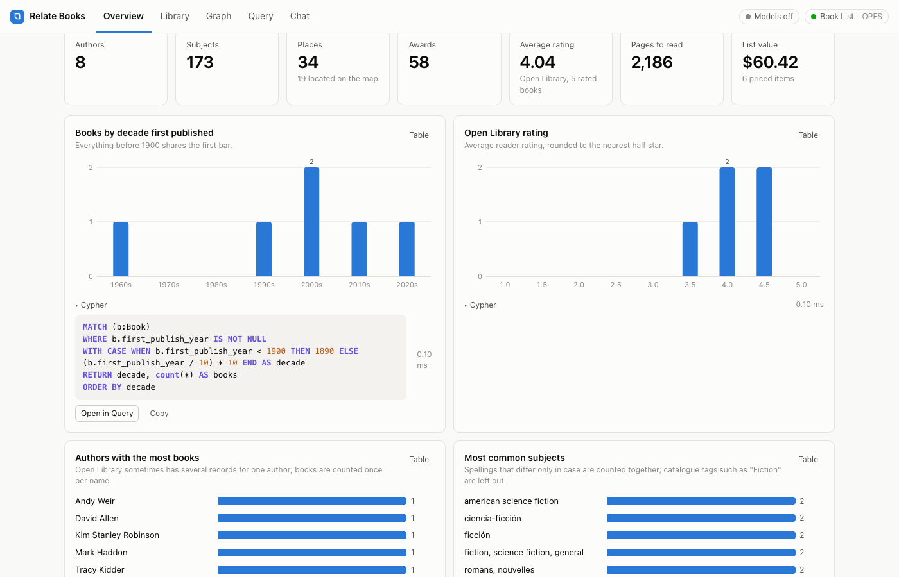
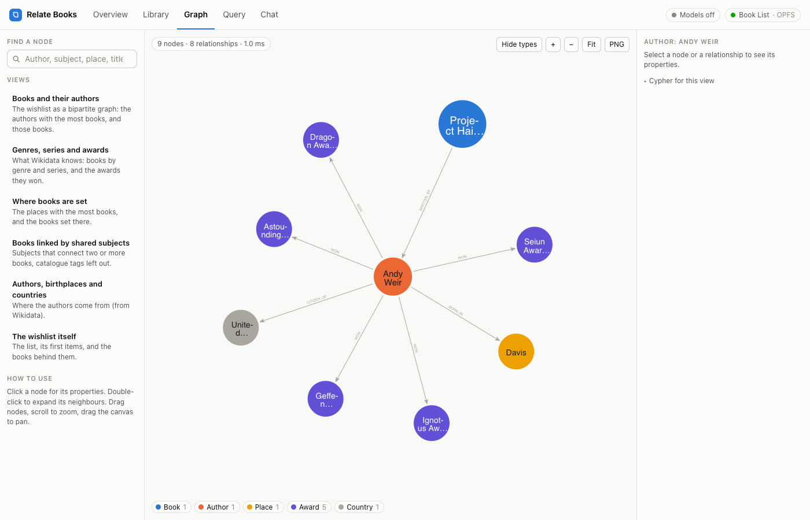
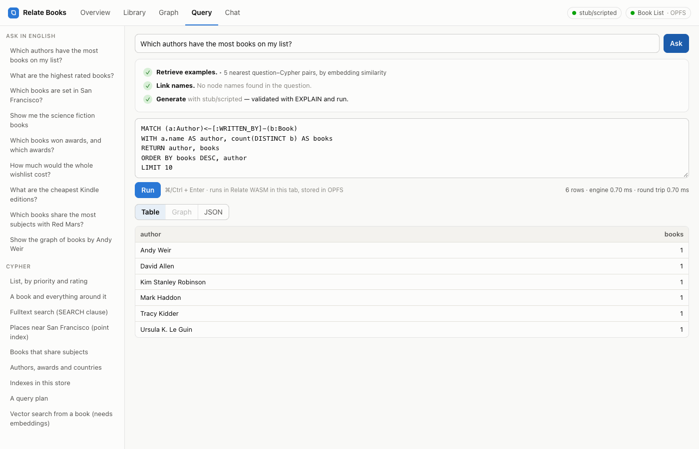

# relate-book

An Amazon wishlist as a reading-list graph, an iPhone app to live in it, and a
browser app to explore it. Built on [Relate](https://relatedb.ai), the embedded
Cypher graph database.

Three parts:

1. **`wishlist-to-graph/`**, a Relate **extension** (`relate run wishlist-to-graph`).
   It fetches a public Amazon wishlist, writes every item into a graph the host
   owns, enriches each book from Open Library (authors, subjects, places,
   characters, ratings, reading-log counts, descriptions, covers), optionally
   adds Google Books, Hardcover and Wikidata facts (genres, series, awards,
   author birthplaces and citizenship), and with `--geocode` puts the places
   on a map through Nominatim.
2. **`ios/`**, **Relate Books**, a SwiftUI iPhone app that bundles an exported
   store (a small public sample; swap in your own) and opens it with the
   embedded Relate engine. Browse and filter the
   list, open book, author and subject pages, mark books read, rate and tag
   them, keep notes, search semantically with an on-device MiniLM model,
   explore the books on a map, and add new books from Open Library, an ISBN
   barcode or by hand. Everything except the add-book lookups and cover
   images works offline.
3. **`web/`**, **Relate Books for the browser**: the same graph loaded into
   Relate compiled to WebAssembly, with nothing running on a server. Charts,
   a graph explorer drawn with NVL, hybrid semantic search, a Cypher console,
   and two models that run in the tab (MiniLM embeddings and a WebGPU
   language model) for asking questions in English (text to Cypher) and for
   an agent that answers by querying the graph.

<p>
  
  
  
  
  
</p>

## Quick start: the graph

```bash
curl -sSfL https://relatedb.ai/install.sh | bash          # the relate CLI (macOS, Linux)
relate extension install wishlist-to-graph --from ./wishlist-to-graph
relate run wishlist-to-graph https://www.amazon.com/hz/wishlist/ls/XXXXXXXXXXXXX \
    --contact you@example.com --wikidata -d ./books.rl
relate run wishlist-to-graph --geocode -d ./books.rl      # places -> coordinates (about 9 min for 700 places)
relate query -d ./books.rl "MATCH (a:Author)<-[:WRITTEN_BY]-(b:Book)
  RETURN a.name AS author, count(b) AS books ORDER BY books DESC LIMIT 10"
```

Flags, the graph model, how books are resolved, the geocoder's rules, starter
queries and caveats: [`wishlist-to-graph/README.md`](wishlist-to-graph/README.md).

## Quick start: the app

```bash
cd ios
scripts/setup_relate.sh                   # once: Relate at the pinned commit, engine built locally (needs rustup)
export RELATE_LOCAL_XCFRAMEWORK=1         # for every swift and xcodebuild command
xcodegen generate
swift test                                # 270 core tests on the Mac
xcodebuild -project RelateBooks.xcodeproj -scheme RelateBooks \
  -destination 'platform=iOS Simulator,name=iPhone 17' -derivedDataPath /tmp/rb-dd build
```

Then install and launch on the simulator, or open the project in Xcode
(`open -a Xcode --env RELATE_LOCAL_XCFRAMEWORK=1 RelateBooks.xcodeproj`). Requirements, launch arguments, the embedding pipeline, map data, the
add-book importer, binary sizes and the store lifecycle:
[`ios/README.md`](ios/README.md).

## Quick start: the web app

```bash
cd web
npm install
npm run dev                                # http://localhost:5173, the six-book sample
npm run export-store -- ../books.rl        # your own list -> web/local/books.json (git-ignored);
                                           # the dev server then opens it instead of the sample
npm test && npm run e2e                    # 95 unit tests on the WASM engine, 12 browser tests
```

<p>
  
  
  
</p>

How the engine worker, the dataset export, search, text to Cypher and the
agent work, what was measured, and the licences of what it downloads:
[`web/README.md`](web/README.md).

### The bundled sample, and using your own list

The app ships with `ios/RelateBooks/Resources/books.rl`, built from a public
six-book sample wishlist (`https://www.amazon.com/hz/wishlist/ls/9N4X43GP6SVK`):
Getting Things Done, Red Mars, The Curious Incident of the Dog in the
Night-Time, A Truck Full of Money, Project Hail Mary and The Left Hand of
Darkness. To rebuild it, or to put your own list in the app:

```bash
relate run wishlist-to-graph <wishlist-url> --wikidata --geocode -d ./books.rl
ios/scripts/refresh_store.sh ./books.rl     # copies it into the app's resources
```

Your own export stays out of git (`*.rl` is ignored except the bundled
sample), but **do not commit or publish it if your list is personal**: the
store records the list id and URL. The tests do not depend on the bundled
list being large. The perf suites scale it to 1,800 books in a temp copy
(`ios/Tests/RelateBooksCoreTests/ScaledLibrary.swift`), and the functional
and UI tests are written against the sample's six books.

## Requirements

- **Relate.** The extension, the bundled store and the web app use Relate
  1.0.1. The iOS app uses the Swift API that Relate's `main` branch gained
  after 1.0.1, which no release carries yet: `ios/scripts/setup_relate.sh`
  fetches the pinned commit into `ios/Vendor/relate` (git-ignored) and builds
  the engine there, which needs `rustup`. Details and the way back to a
  release are in [`ios/README.md`](ios/README.md).
  The `relate` CLI (for the extension and ad-hoc Cypher) comes from the
  installer above, the [release page](https://github.com/relatedb/relate/releases),
  or `cargo build --release -p relate-cli` in a Relate checkout.
- **Python 3.10+** for the extension (standard library only).
- **Xcode 27**, **xcodegen** and an iOS 26 simulator for the app. `uv` only if
  you regenerate the Core ML model.
- **Node 22+** for the web app; Chrome for its end-to-end tests. A browser
  with WebGPU for the language model (the rest works without).

## Layout

```
wishlist-to-graph/
  extension.json          the manifest relate parses (flags, commit policy, executable)
  wishlist-to-graph.py    the extension: MCP client glue, the wishlist walk, enrichment, geocoding
  README.md
ios/
  project.yml             xcodegen spec -> RelateBooks.xcodeproj (both committed)
  Package.swift           RelateBooksCore library + Swift Testing suites
  RelateBooks/            app sources (Graph/, Embedding/, Search/, OpenLibrary/, Geo/, ViewModels/, Features/, App/)
  Tests/, UITests/        core tests (macOS) and XCUITests (simulator)
  docs/                   simulator screenshots, phase by phase
  scripts/                setup_relate.sh, refresh_store.sh, convert_embedding_model.py
web/
  src/                    engine worker, Cypher, search, text2cypher, agent, React UI
  scripts/export-store.mjs  a .rl store -> the JSON dataset the browser loads
  public/data/sample.json the public sample as a dataset
  tests/, e2e/            Vitest (real WASM engine in Node) and Playwright
docs/
  ios-app-plan.md         the plan, every decision, and a changelog per phase
  research.md             how Relate extensions, Amazon wishlist pages and the metadata sources behave
AGENTS.md                 conventions for coding agents (CLAUDE.md imports it)
```

### Data files and git

- `books.rl` at the root is the extension's output and is **git-ignored**
  (`*.rl`), as is `backups/`. The copy the app bundles,
  `ios/RelateBooks/Resources/books.rl` (the six-book sample, 212,992 bytes,
  with Wikidata facts and geocoded places), **is tracked** so a clone builds
  and the tests run. Refresh it with `ios/scripts/refresh_store.sh`.
- The Core ML model `ios/RelateBooks/Embedding/Model/MiniLM_L6_v2.mlmodelc`
  (45 MB, mostly `weights/weight.bin`) is tracked too. It is below GitHub's
  file-size limit, but it is binary and changes rarely. If it ever needs to be
  replaced more than once or twice, move it to Git LFS. It is reproducible
  byte for byte with `ios/scripts/convert_embedding_model.py`.
- `web/public/data/sample.json` (the sample as the browser loads it, 48 KB)
  is tracked; `web/local/` (your own export) is ignored, and so are
  `web/node_modules/` and `web/dist/`.
- Nothing here contains credentials. The extension reads an optional
  `GOOGLE_BOOKS_API_KEY` and `HARDCOVER_API_TOKEN` from the environment at run time.

## Status

- **Extension** 0.2.0. On relate 1.0.1 the sample list imports with
  `--wikidata --geocode` in about 30 seconds (6 books, 8 authors, 173
  subjects, 58 awards, 34 places, 19 on the map). On relate 0.16.1, a
  2,002-item amazon.com list imported in 52 minutes (1,811 books, 1,757
  resolved) and geocoded in 9 minutes (600 of 693 places located). Google
  Books and Hardcover are wired but have not been run end to end (no
  credentials).
- **App** phases 0 to 5 of the plan are implemented and verified on the
  iPhone 17 simulator: scaffold, browse, reading status/tags/notes, semantic
  search, map, add books. 270 core tests, 12 UI tests. Since 2026-11-15 it is
  built on Relate's unreleased Swift API (see Requirements). Phase 6 (offline covers,
  importing a newer export, export, share) is next.
- **Web app** implemented and verified in Chrome on the sample and on a
  1,811-book list (17,431 nodes load in 2.3 s; every book embedded in about
  3 s on WebGPU). 95 unit tests, 12 end-to-end tests. Measurements and the
  language-model evaluation are in [`web/README.md`](web/README.md).

## Privacy and rate limits

The extension and the app identify themselves to Open Library and Nominatim
with a User-Agent that names this repository. A contact address is sent only
when you pass `--contact`. Both respect the services' one-request-per-second
guidance; the extension caches geocoding results in
`~/.cache/relate-book/geocode.json` so re-runs make no requests. The web app
has no backend: the graph, searches and questions stay in the browser tab. It
downloads model files from Hugging Face when you turn a model on, and loads
cover images from Open Library and Amazon.

## Amazon

The extension reads the public HTML of a wishlist you point it at, slowly
(one page every 1.5 s by default) and only when you run it. Use it on lists
you own or have been given, and check that your use fits Amazon's Conditions
of Use. This project is not affiliated with or endorsed by Amazon.

## Contributing

Issues and pull requests are welcome. [`AGENTS.md`](AGENTS.md) is the short
guide to conventions, build and test commands, and the rules that are easy to
get wrong; it applies to humans and coding agents alike. In short: core logic
comes with a Swift Testing case, Cypher is tried on a store copy with the CLI
before it lands in a query file, the perf suite stays green, and behaviour
changes go into the changelog in [`docs/ios-app-plan.md`](docs/ios-app-plan.md)
and the README closest to the code.

## License

[Apache License 2.0](LICENSE). Third-party material (the MiniLM model, the
data in the sample store, map and cover imagery in the screenshots, and the
web app's dependencies and run-time models) is listed in [`NOTICE`](NOTICE).
Note for the web app: the graph library it uses, NVL, is not open source and
its licence limits what it may be used with; see `NOTICE` before hosting it.
