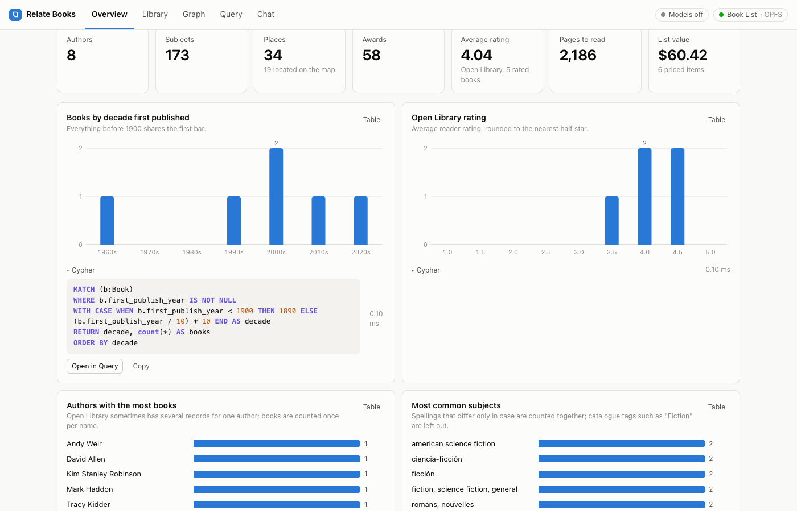
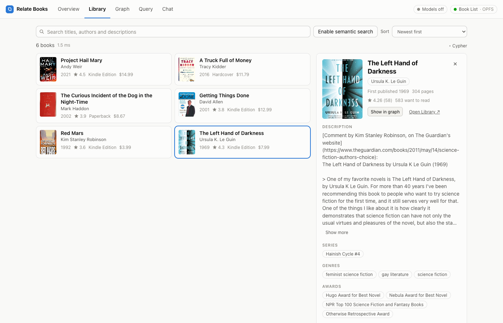
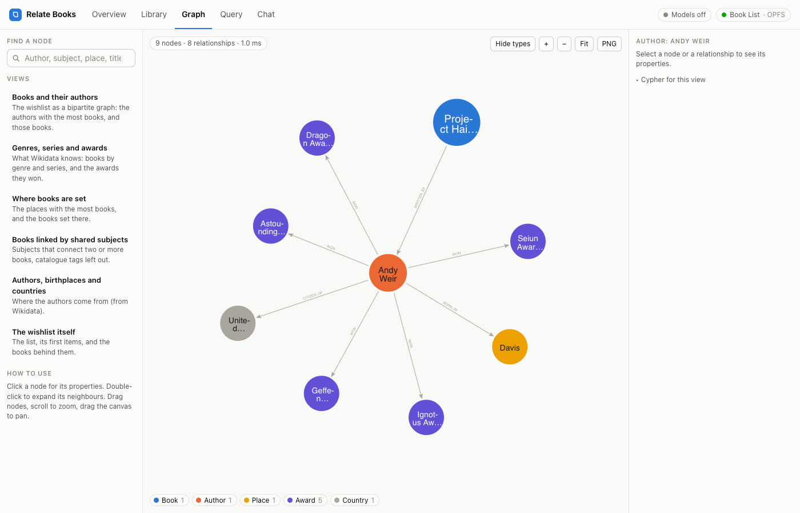
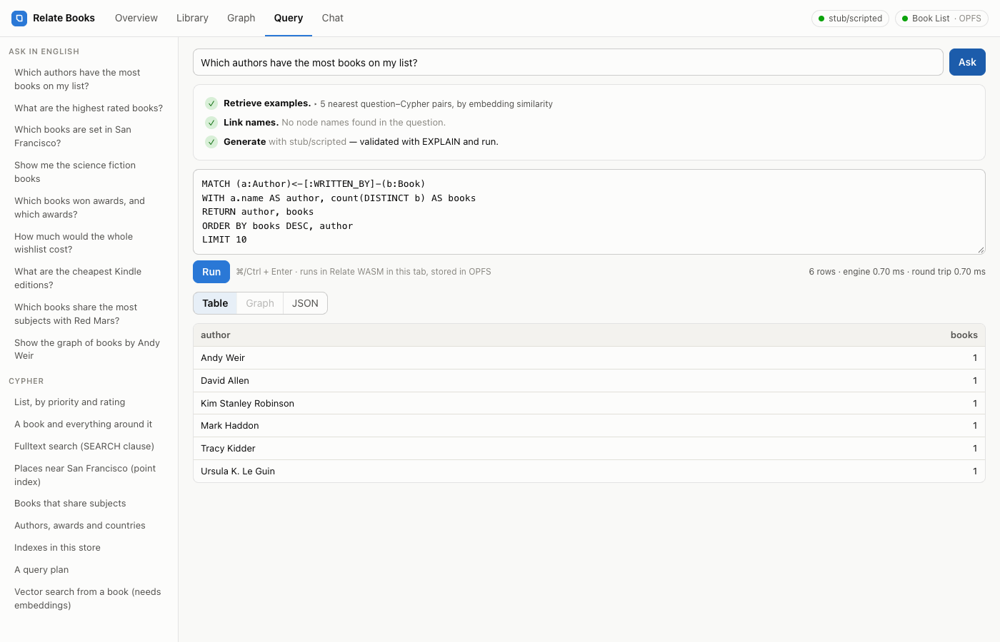
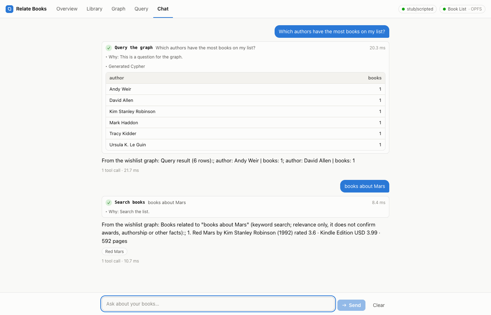

# Relate Books (web)

A book wishlist as a graph, explored entirely in the browser. The graph lives
in [Relate](https://relatedb.ai) compiled to WebAssembly
([`@relate/relate-wasm`](https://www.npmjs.com/package/@relate/relate-wasm)
1.0.1), the drawings are [NVL](https://neo4j.com/docs/nvl/current/), and two
models run in the tab: an embedding model (all-MiniLM-L6-v2, transformers.js)
and a language model (WebLLM on WebGPU). There is no server: after the static
files and the models are downloaded, nothing leaves the page.

<p>
  
  
  
  
  
</p>

(The screenshots show the public six-book sample with the stubbed models the
tests use.)

## What it shows

| Tab | What you can do | Relate feature behind it |
| --- | --- | --- |
| **Overview** | Totals, eight charts (decade, rating, authors, subjects, places, formats, length, awards), the graph model with counts. Every bar opens the books behind it; every chart shows its Cypher and has a table view. | Aggregation, `CASE` bins, `COUNT {}`, timings from the wire envelope |
| **Library** | Browse, sort, open a book page (authors, subjects, places, awards, series, editions), follow any tag. Search by keyword, or by meaning once the embedding model is on; "More like this". | Fulltext indexes with the `SEARCH` clause, a vector index on `Book.embedding`, reciprocal rank fusion |
| **Graph** | Six ready-made views, "find a node", click for properties, double-click to expand, drag, zoom, export PNG. | Paths and pattern queries returned as nodes and relationships, drawn by NVL |
| **Query** | A Cypher console (table, graph, JSON and plan views; engine time and round-trip time; writes allowed). Above it, **Ask**: type a question, watch it become Cypher. | `execute`, `EXPLAIN`, plan notifications, the `opfs://` durable store |
| **Chat** | An agent that plans tool calls (semantic search, generated Cypher, book lookup, similar books), runs them on the graph and answers from the results. Each step shows what it ran. | All of the above, in a loop |

## Quick start

```bash
cd web
npm install
npm run dev            # http://localhost:5173, opens the six-book sample
```

Needs Node 22 or newer and a current browser. The engine, charts, graph and
keyword search work everywhere WebAssembly does. Semantic search uses WebGPU
when the browser has it and falls back to WASM. The language model needs
WebGPU (current Chrome, Edge or Safari).

### Your own wishlist

The browser build of Relate cannot open a `.rl` file (no filesystem, no Parquet
codec), so a store crosses as a JSON export:

```bash
npm run export-store -- ../books.rl      # -> web/local/books.json (git-ignored)
npm run dev                              # the dev server now opens your list
```

`export-store` needs the `relate` CLI on `PATH` (or `--relate BIN`). It copies
the store to a temp directory and opens the copy read-only. A 1,811-book list
(17,431 nodes, 30,365 relationships) exports in under 2 seconds to a 5 MB file.

With a build served somewhere else, use the dataset chip (top right) →
**Open an export…** and pick the file. It is read in the browser and never
uploaded.

**A personal export records the list id and URL. Keep it out of git and off
public hosts.** `web/local/` is ignored for that reason, and the dev server
route that serves it (`/local-data/`) does not exist in a build.

### The models

Nothing is downloaded until you ask. The chip next to the dataset opens the
**Models** panel:

- **Embedding model**: `Xenova/all-MiniLM-L6-v2`, 384 dimensions, about 90 MB
  (full precision, on WebGPU) or 23 MB (8-bit, on WASM). Once loaded, every
  book is embedded and the vectors are written into the graph.
- **Language model**: pick one and load it. The default is Qwen2.5 Coder 3B
  (4-bit, about 2 GB to download, 2.5 GB of GPU memory). Its licence is the
  Qwen Research Licence, which is for research use. The 1.5B and 7B sizes are
  Apache-2.0; "How well the models do" below says what you give up with each.

Both are cached by the browser; a model that was on last time loads again on
the next visit if it is still cached.

## Commands

```bash
npm run dev             # dev server
npm test                # unit tests: expect "Tests  95 passed (95)" in 8 files, about 1 s
npm run e2e             # Playwright in installed Chrome: 12 tests (10 on the dev server, 2 on a production build), about 30 s
npm run typecheck       # tsc --noEmit
npm run build           # typecheck, then a static build in dist/
npm run export-store -- STORE [--out FILE] [--relate BIN] [--name TITLE]
npm run refresh-sample  # rebuild public/data/sample.json from ios/RelateBooks/Resources/books.rl
```

The unit tests run the same WASM bundle the browser runs, in Node, against the
sample dataset. The end-to-end tests use `?dataset=sample&stub-ai`, so they
need no network, no GPU and no model. Two of them build the app, serve it
under a sub-path and drive that, because asset, worker and dataset URLs
resolve differently in a build (the first version of this app loaded its
sample in the dev server and not in a build). `SCREENSHOT_DIR=/abs/dir npm run
e2e` saves the screenshots in `docs/`.

URL flags (the last two only in the dev server):

| Flag | Effect |
| --- | --- |
| `?memory` | Use the in-memory database even where OPFS works |
| `?dataset=sample` | Ignore a local export when choosing what to load into an empty store |
| `?stub-ai` | Replace both models with deterministic stand-ins (a hashed bag-of-words embedder and a scripted LLM) |

In the dev server, `window.__relateBooks` holds the engine client and
`ask(question)` / `chat(question)` for trying the pipelines from the console.

## How it works

```
src/
  engine/      Relate WASM in a dedicated worker; the dataset loader; the graph model
  queries/     Cypher for each tab (no React): overview, library, search, graph
  search/      keyword sanitizer, rank fusion, embedding text, the indexer (ports of the iOS app's)
  ai/          model runtimes (WebLLM worker, transformers.js worker), text2cypher/, agent/
  state/       React providers: engine, navigation, models
  features/    one folder per tab, plus the models panel
  components/  NVL canvas, charts, tables, Cypher blocks
scripts/export-store.mjs    .rl -> dataset JSON, through the relate CLI
public/data/sample.json     the public six-book sample (tracked)
tests/  e2e/                Vitest and Playwright
```

### The engine

`src/engine/engine.worker.ts` hosts the database in a dedicated worker, for two
reasons: the durable `opfs://relate-books` store only exists there (it needs
`FileSystemSyncAccessHandle`), and a runaway query can be stopped by
terminating the worker. `src/engine/client.ts` is the page's side: a status the
UI subscribes to, a 30-second default timeout per statement, and recovery. On a
timeout or a WASM trap it starts a new worker; the OPFS store is reopened, or
an in-memory graph is loaded again.

Where OPFS is unavailable, or another tab holds the store, the tab falls back
to an in-memory database and says so in the dataset menu. Switching datasets
wipes the stored copy and loads the new one.

### Loading a dataset

`scripts/export-store.mjs` writes every node and relationship, grouped by label
set and relationship type, plus the DDL for the store's constraints and
indexes. Values JSON cannot carry (points, datetimes, vectors) are listed per
group and rebuilt with `point()`, `datetime()` and `vector()` on load.

`src/engine/dataset.ts` loads it into an empty database: constraints, nodes in
batches of 2,000 (`UNWIND $rows ... CREATE ... RETURN row[0], id(n)`),
relationships by `id()` lookup of the new node ids, then the remaining
indexes. Nothing temporary is written to the graph. A dataset is checked
before anything runs: its schema statements must be `CREATE CONSTRAINT` or
`CREATE ... INDEX`, and labels, types and keys are quoted.

After a load the app adds its own DDL (`src/engine/schema.ts`): the vector
index `book_embedding`, and `term_text`, one fulltext index over the names of
authors, subjects, genres, places, people, series, awards, publishers, eras
and countries.

### Search

A port of the iOS app's hybrid search, without notes:

1. the query is embedded in the browser and matched on the vector index
   (top 50, cosine at least 0.25);
2. `book_text` and `item_text` fulltext hits are merged per book and kept only
   when the book contains every query term (Relate's fulltext ranking ORs the
   terms);
3. the two lists are fused with reciprocal rank fusion (k = 60).

User text never reaches a fulltext index raw: `KeywordQuery` lower-cases it
and drops `and`/`or`/`not`, which Relate 1.0.1 reads as operators in upper
case. Parameters cross into WASM as JSON, so a vector is a plain list wrapped
in `vector($q, 384, FLOAT32)` inside the statement.

The text a book is embedded from is the iOS app's
(`title · authors · up to 15 subjects · description`), with mean pooling, L2
normalisation and a 256-token limit. Each vector is stored with the model id
and a hash of its text, so a second run only embeds what changed, and a vector
from another model is never searched.

### Text to Cypher

`src/ai/text2cypher/pipeline.ts`, in the order the Query tab shows it:

1. **Retrieve.** The question is embedded and compared with the
   question–Cypher pairs in `examples.ts` (45 of them, each one run against
   the sample by the tests); the five nearest become few-shot examples.
   Without the embedding model, shared words pick them.
2. **Link names.** The `term_text` index and book titles are searched for
   names the question spells out in full. Those go into the prompt with their
   exact spelling. This is deliberately strict: a wrong hint steers the model
   more than a missing one (a book titled "The Prize" must not be linked for
   "Pulitzer Prize").
3. **Generate.** The model sees the graph model (labels and relationship types
   present in the loaded graph), the commonest countries, genres and formats,
   a short list of dialect rules, the examples and the question. Temperature 0,
   repetition penalty off.
4. **Check.** Before anything runs:
   - a lexical read-only guard (one statement; no `CREATE`, `MERGE`, `SET`,
     `DELETE`, `REMOVE`, `DROP`, `LOAD CSV`, unknown procedures);
   - relationship directions against the graph model. A backwards arrow is
     flipped in place; a relationship between labels the model does not
     connect goes back to the model;
   - a number that lost its last digit is restored from the question, and a
     doubled closing brace is dropped;
   - `EXPLAIN`: syntax errors, unknown labels, types and properties (from the
     plan's notifications), and the plan's operators as the engine's own word
     that the statement does not write;
   - properties read from the wrong label (`b.price` on a Book), which the
     engine cannot flag because the key exists elsewhere.
5. **Repair.** Any problem is sent back with what is valid instead, up to two
   times.
6. **Run** with a 15-second limit and a `LIMIT` if the statement had none.

Relate WASM has no per-statement read-only mode, so generated Cypher is kept
read-only by the guard and the plan check together. The Cypher console itself
runs whatever you type, writes included.

### The chat agent

`src/ai/agent/loop.ts` is a small ReAct loop shaped for small models:

- Each step, the model emits one JSON object, `{thought, tool, input}`,
  constrained by a JSON schema (WebLLM's grammar-constrained decoding), so it
  always parses and always names a real tool.
- Tools take one string: `search_books` (hybrid search), `query_graph` (the
  whole text-to-Cypher pipeline), `book_details`, `similar_books`.
- The first graph lookup of a new conversation gets the user's own words, not
  the model's paraphrase of them, and a failed paraphrase is retried once with
  the user's wording: paraphrasing was where most lookups went wrong.
- Observations go back into the conversation; an identical call is refused; at
  most four steps.
- The answer is a second, unconstrained generation over the observations,
  streamed as it is written.

## Measurements

On a MacBook Pro (Apple M4 Max), Chrome 157, 2026-11-14. "Full list" is a
1,811-book export: 17,431 nodes, 30,365 relationships, 5.1 MB of JSON.

| What | Sample (6 books) | Full list (1,811 books) |
| --- | --- | --- |
| Load into Relate WASM (OPFS store) | 0.1 s | 2.3 s |
| Reload, store reopened from OPFS | under 1 s | 2.7 s |
| Engine memory after load | 19 MB | 60 MB (104 MB with embeddings) |
| Overview charts, engine time each | under 2 ms | 2 to 114 ms (most under 15 ms) |
| Book list page (60 books) | 25 ms | about 10 ms engine time |
| Hybrid search, end to end | about 120 ms | 85 to 130 ms |
| Embed every book (WebGPU, model cached) | under 1 s | about 3 s |

Models, same machine, first use on a fast connection (download and start):
embedding model 7 s; Qwen2.5 Coder 1.5B 21 s; 3B 35 s; 7B 2 min 20 s. From the
browser cache each starts in a few seconds.

Build output (`npm run build`): `relate_bg.wasm` 6.9 MB (2.5 MB gzipped), app
JavaScript 1.4 MB (0.4 MB gzipped); loaded only when used: WebLLM 6 MB,
ONNX Runtime 27 MB.

### How well the models do

Measured on 2026-11-14 on the full list, with questions that are not among
the examples. Small samples: treat a difference of one or two as noise.

**Text to Cypher**, 20 questions:

| Model | Ran | Answered the question as asked | What went wrong | Time per question |
| --- | --- | --- | --- | --- |
| Qwen2.5 Coder 1.5B | 20 | 18 | one unasked extra filter; one author name matched too exactly (no rows) | 2 to 4 s |
| Qwen2.5 Coder 3B (default) | 19 | 17 | one never produced valid syntax; one filter with wrong operator precedence; "Nobel Prize winners" read as a subject | 3 to 8 s (15 s with both repair rounds) |
| Qwen2.5 Coder 7B | 18 | 18 | two never produced valid syntax (a doubled closing parenthesis, repeated in every repair) | 4 to 9 s |

Before the changes listed under "Decisions", the 3B model answered thirteen
of a different twenty on the sample; seven failed on a backwards relationship,
a truncated number, or a misleading name hint.

**Chat agent**, 10 turns (recommendations, facts, a two-part question, a book
lookup, small talk):

| Model | Good answers | Said it could not answer | Wrong | Time per turn |
| --- | --- | --- | --- | --- |
| Qwen2.5 Coder 3B (default) | 5 | 4 | 1 (reported the number of editions as the number of books) | 2 to 15 s (28 s when a lookup fails) |
| Qwen2.5 Coder 1.5B | 4 | 2 | 4 (invented an award and two ratings; nonsense on "thanks!" and on one ranking question) | 1 to 12 s |

What to take from this:

- For **Ask**, all three sizes are about equally good, so the 1.5B (Apache-2.0,
  half the download, the fastest) is a reasonable choice.
- For **Chat**, use the 3B. It picks a sensible tool and, when a lookup fails,
  mostly says so. The 1.5B states things the tools never returned.
- The agent is weaker than Ask on factual questions: about half of the turns
  end in a good answer. Phrases like "of my books" and two-part questions
  still trip the Cypher step. Open a step to see exactly what ran and what
  came back, or ask the same thing in the Query tab.
- The 7B was not better here and is slower. Its chat run (on an earlier
  revision of the prompts) was no better than the 3B's.

## Decisions and what they cost

- **A JSON export, not the `.rl` file.** Relate's wasm32 build has no Parquet
  codec and no filesystem, so the store cannot be opened in place. The export
  is a build step for the sample and one command for your own list.
- **OPFS first, memory as the fallback.** The stored copy means a reload does
  not import again and the embeddings (the only expensive data) are computed
  once. It costs one store per origin: a second tab runs in memory.
- **The repetition penalty is off.** Qwen2.5 ships with 1.05. With it on,
  generated Cypher had more broken brackets (`[:WON)` for `[:WON]`). Turning
  it off reduced them; it did not end them.
- **Deterministic repairs before model repairs.** Flipping a backwards
  relationship, restoring a truncated number and dropping a doubled brace are
  done in code and shown in the trace; they are instant, and each is applied
  only when the statement is otherwise unambiguous. Everything else goes back
  to the model with the valid alternatives.
- **Strict name linking.** Linking any name that shares a word with the
  question made answers worse ("American" linked a subject called "American
  literature"; "awards" linked an award). Every word of a name must be in the
  question.
- **One string per tool, JSON-schema output.** Free-form function calling is
  unreliable at this model size; a constrained object with a single string
  field is not.
- **Charts are hand-built HTML and SVG.** One hue for magnitude, thin marks, a
  table view of every chart, tooltips on hover and focus. No chart library.
- **No map.** The iOS app has one; a web map needs a tile server, and this app
  talks to no service of its own.

## Network and privacy

The page requests, and only when you use the feature:

| Host | What for |
| --- | --- |
| `huggingface.co` and its CDN | The embedding model and the language model weights |
| `raw.githubusercontent.com` | WebLLM's compiled model libraries (`.wasm`) |
| `covers.openlibrary.org`, `m.media-amazon.com` | Book covers, hot-linked with `referrerpolicy="no-referrer"` |

Your graph, your searches and your questions are never sent anywhere: the
database, both models and the agent run in the tab. NVL's telemetry is turned
off (`disableTelemetry`).

## Hosting a build

`dist/` is static and uses relative URLs, so it can be served from any path.
OPFS and WebGPU need a secure context (HTTPS or `localhost`). No cross-origin
isolation headers are required. A build contains the sample only.

## Licences

The code here is Apache-2.0, like the rest of the repository. Two dependencies
deserve a look before you redistribute or host this app:

- **NVL** (`@neo4j-nvl/*`) is not open source. Its licence allows use only with
  Neo4j Aura or Neo4j's commercial database products. This app uses it with
  Relate because it was asked for by name; check that your use is covered, or
  replace `src/components/GraphCanvas.tsx` (the only file that imports it).
- The models are downloaded by the user's browser from their publishers and
  are under their own licences. all-MiniLM-L6-v2 is Apache-2.0. The default
  language model, Qwen2.5 Coder 3B, is under the Qwen Research Licence
  (research use); the 1.5B and 7B sizes are Apache-2.0. The Models panel shows
  the licence next to each model.

See [`../NOTICE`](../NOTICE).

## Limits

- The language model needs WebGPU and about 2.5 GB of GPU memory for the
  default. Without it, Ask and Chat are unavailable and everything else works.
- Only the three Qwen2.5 Coder sizes were measured. Llama 3.2, Phi-4 mini and
  Qwen3 are offered untested.
- The measurements are from one machine (Apple M4 Max). A weaker GPU will be
  slower, and may not fit the larger models.
- One store per origin: a second tab runs in memory.
- The graph canvas is meant for hundreds of nodes; expansion stops at 600.
- An export is a snapshot. To pick up a re-import, export again.
- The app edits nothing in the graph except the embeddings, unless you write
  Cypher that does.
